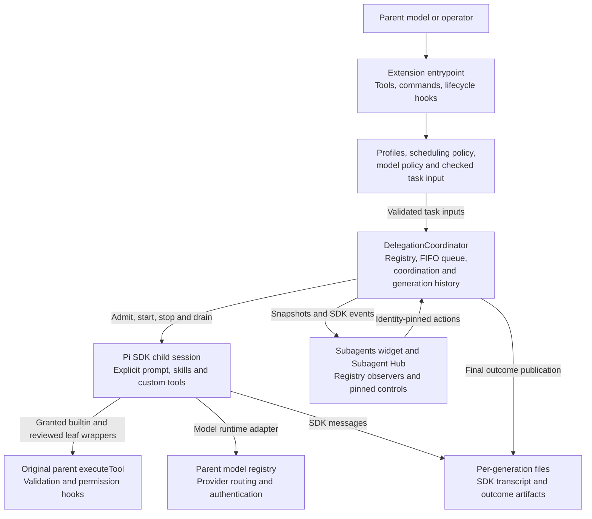

# Architecture

This document explains how `@howarewoo/pi-subagents` delegates work inside a live Pi session. It is intended for contributors who need to locate behavior, understand lifecycle and permission boundaries, or change the extension without bypassing its execution contract.

It describes the current implementation, not a proposed architecture. For exact tool inputs and operator configuration, use the [delegation contract](docs/delegation-contract.md); for installation and usage, start with the [README](README.md).

## System boundary

The package is a TypeScript ES-module Pi extension. [package.json](package.json) registers [index.ts](index.ts) as its production entrypoint, re-exporting [src/pi-extended-subagents.ts](src/pi-extended-subagents.ts). The root index lets Pi show the npm package name without an entrypoint suffix; local installs retain path-derived labels. Node 22.19+ is required; the repository pins its development SDK dependencies to Pi 1.5.2. There is no separate daemon or remote worker service.

The parent extension creates child sessions through Pi's public SDK. Each child has its own assignment, SDK conversation, explicit resources, execution budgets, and transcript. Children remain owned by the live parent runtime: they do not survive shutdown or reload, and saved transcripts do not restore the registry after restart.



The original parent dispatcher remains the authority for child builtin and reviewed leaf calls. Selecting a workspace changes explicit tool arguments and the child session's cwd; it does not create a filesystem sandbox or transfer trust to that workspace.

## Source map

| Module                                                   | Responsibility                                                                                                                                                                                         |
| -------------------------------------------------------- | ------------------------------------------------------------------------------------------------------------------------------------------------------------------------------------------------------ |
| [pi-extended-subagents.ts](src/pi-extended-subagents.ts) | Registers `delegate_task`, `delegate_coordinate`, and `subagent`; resolves requests and configuration; adapts compatibility calls; owns lifecycle hooks, completion messages, commands, and UI wiring. |
| [tool-schemas.ts](src/tool-schemas.ts)                   | TypeBox input schemas for the three model-facing tools.                                                                                                                                                |
| [coordinator.ts](src/coordinator.ts)                     | Authoritative live registry, admission and execution authorization, FIFO dispatch, budgets, cancellation/drain, messages, waits, immutable generation history, and disposal.                           |
| [child-execution.ts](src/child-execution.ts)             | Scoped resources, SDK session setup, parent-dispatched tool wrappers, event observation, prompting, and outcome publication through coordinator-owned execution operations.                            |
| [delegation-types.ts](src/delegation-types.ts)           | Shared task inputs, identity, snapshot, event, message, and wait contracts; also re-exported by the coordinator.                                                                                       |
| [profiles.ts](src/profiles.ts)                           | Bundled roles, operator/trusted-project configuration, explicit skill loading, and grant intersection for renewed assignments.                                                                         |
| [capabilities.ts](src/capabilities.ts)                   | Fail-closed reviewed leaf classification, denial reasons, and public metadata provenance.                                                                                                              |
| [scheduling.ts](src/scheduling.ts)                       | Scheduling defaults, hard ceilings, configuration loading, and limit narrowing. Dispatch itself lives in the coordinator.                                                                              |
| [model-policy.ts](src/model-policy.ts)                   | Exact provider/model/effort selection, model-grant narrowing, availability, scope, and capability validation.                                                                                          |
| [model-adapter.ts](src/model-adapter.ts)                 | Creates a child `ModelRuntime` that forwards requests to the parent's public model registry without copying credentials.                                                                               |
| [workspace.ts](src/workspace.ts)                         | Canonicalizes existing workspace directories and adapts builtin paths and shell commands for the parent dispatcher.                                                                                    |
| [task-input.ts](src/task-input.ts)                       | Checks task-file paths, size, content, and file stability; obtains instruction text through the parent's `read` dispatcher.                                                                            |
| [outcomes.ts](src/outcomes.ts)                           | Compiles a bounded JSON Schema subset, defines structured submission state, publishes exclusive outcome artifacts, and clips previews.                                                                 |
| [hub.ts](src/hub.ts)                                     | Subagent Hub layout, selection, scrolling, in-flight projections, and generation-pinned controls.                                                                                                      |
| [subagent-widget.ts](src/subagent-widget.ts)             | Event-driven, bounded pinned widget for current tasks.                                                                                                                                                 |
| [task-presentation.ts](src/task-presentation.ts)         | Shared labels, summaries, cards, details, and read-only transcript text projections.                                                                                                                   |
| [thread.ts](src/thread.ts)                               | Native Pi message/tool rendering, component caching, and sanitization of terminal-facing content.                                                                                                      |

## Entry points and runtime ownership

On `session_start`, the entrypoint creates one `DelegationCoordinator` using the parent session ID and a storage root beneath the parent session directory. It subscribes to registry changes, emits `delegation:registry` events, and attaches a Subagents widget in TUI mode.

Three model-facing tools share that coordinator:

- **`delegate_task`** accepts one assignment or an ordered batch, with explicit profiles, optional checked task files, narrowed grants, limits, and optional result schemas. Foreground is the default.
- **`delegate_coordinate`** provides live messaging, bounded waits, status, stop, park, and fresh-generation follow-up or revival. Child access is separately granted and restricted.
- **`subagent`** is a compatibility adapter, not a second executor. It maps `worker` to `implementation`, normalizes requests into the existing delegation path, and exposes identities as `UUID@generation`. Launches are asynchronous by default and wake the parent after drain.

Commands `/subagent-profiles` (Subagent Profiles), `/subagent-status`, `/subagent-stop`, `/subagent-steer`, and `/subagent-hub` expose profile information and the same registry to the operator. The former `/task-*` commands and `/agent-hub` are not registered as aliases. Follow-up and revival are model-tool operations, not direct Hub actions.

On `session_shutdown`, the extension closes admission, removes the widget, aborts and drains children, and unsubscribes observers. SDK embedders must emit the public shutdown lifecycle: disposing the parent session alone is not the cleanup contract.

## Request-to-result flow

1. **Resolve the request.** The entrypoint loads scheduling and profile configuration from the root parent context. It resolves the existing task workspace and requires exactly one of inline `assignment` or `taskFile`. A supplied alternate workspace does not become a new source of project trust or project delegation configuration.
2. **Narrow permissions.** Requested spawn, coordination, and model grants must already exist in the effective profile. Task-file instructions are read through the parent dispatcher after path and metadata checks.
3. **Preflight the whole batch.** `DelegationCoordinator.admit()` intersects each profile's tool ceiling with callable parent tools, verifies builtin provenance, validates model selection and result schemas, checks ancestry and budgets, and computes queue capacity. No child is registered, set up on disk, or dispatched until all items pass. Preflight may already have read configuration, skills, and task files.
4. **Register and queue.** Admission assigns UUID/generation identities, creates snapshots and completion promises, starts deadlines, and appends entries to the FIFO queue.
5. **Dispatch when eligible.** The coordinator reserves concurrency before SDK setup. It invokes `createChildExecution()` to create a fresh task directory, scoped resources, parent-routed model runtime, custom tool wrappers, and SDK session.
6. **Run and observe.** The SDK prompts the child with its assignment. Events update progress, activity, model usage, transcript references, and observers. Builtin calls go through the original parent dispatcher.
7. **Drain and finalize.** On prompt completion or failure, the executor asks the coordinator to stop and drain active descendants. On the normal prompt-resolution path the executor publishes outcome artifacts and updates the terminal outcome through its owner interface. Coordinator disposal captures messages, releases the SDK session, resolves waiters, and pumps the queue.

`child-execution.ts` operates on the same live execution record as the coordinator, not a copy or a second state machine. Its typed owner interface is bound to the exact admitted entry and reads shutdown state through a live getter. The coordinator retains authorization, budget charging, descendant drain, and disposal; the executor owns SDK mechanics and artifact publication. Existing coordinator type and `childResources` imports remain available through re-exports.

A foreground invocation waits for every admitted child and returns results in input order. A background invocation returns snapshots immediately, then emits one ordered completion message when every batch member actually drains. Both native and compatibility async paths request a parent turn via public `sendMessage(triggerTurn:true,deliverAs:"followUp")`: idle parents wake; busy parents queue a follow-up. Direct root resume/followup/revive each register one existing wait promise for the returned identity/new execution window; renewal reports the new generation. Adapter formatting does not choose whether to wake. Foreground and rejected calls add no completion notice. Closing/replaced-coordinator guards suppress stale callbacks. Outcomes include pause/failure/cancellation, not permission to auto-resume; a requested turn is not guaranteed task continuation and may incur provider costs. No polling, new lifecycle service or forced continuation loop is involved. A failed child does not automatically cancel its batch siblings.

## Lifecycle and scheduling

The execution state is separate from agent presence:

```mermaid
stateDiagram-v2
    [*] --> queued: Batch admitted; deadline starts
    queued --> setup: FIFO capacity
    queued --> cancelled: Stop before setup
    queued --> pausing: Deadline before setup
    setup --> pausing: Deadline
    running --> pausing: Deadline
    pausing --> paused: Actual subtree drain; release capacity
    paused --> queued: Explicit continuation; same SDK context/identity
    paused --> cancelled: Stop or shutdown
    setup --> running: SDK agent_start
    setup --> failed: Setup failure
    setup --> draining: Stop during setup
    running --> draining: Completion, stop or hard request/tool limit
    running --> failed: Run rejects after descendant drain
    draining --> settled: Successful finalization
    draining --> failed: Model, required result or persistence failure
    draining --> cancelled: Cancellation or aborted outcome
    settled --> [*]: Dispose and release resources
    failed --> [*]: Dispose and release resources
    cancelled --> [*]: Dispose and release resources
```



This diagram summarizes meaningful paths; cancellation during setup can finalize without reaching `running`. Consumers must use the window completion promise, `paused` state or `disposed` flag for actual drain, rather than treating a terminal status alone as resource release.

Scheduling defaults are 16 concurrent tasks, a 32-item queue, and 16 tasks per batch. Each task defaults to a thirty-minute deadline, 200 direct model requests, and 500 tool calls. Operator configuration can change defaults within hard ceilings; trusted project configuration and individual requests can only narrow their applicable limits. See [scheduling.ts](src/scheduling.ts) for the full policy, including nesting bounds.

Important scheduling consequences:

- The queue is strict FIFO. Writers and readers dispatch in admission order when capacity is free.
- Setup, running work, pausing and draining retain capacity until real drain. Paused entries retain idle SDK sessions but no scheduler permits. Each deadline window begins at admission (or explicit resume), so queue/setup time counts and paused time does not.
- Nested calls are foreground-only. A waiting parent retains its permit; admission rejects nested work that cannot start immediately rather than lending permits or queuing a deadlock.
- Writing tasks and parent tools may run together, including across supplied workspaces. Nested writers obey the same explicit grants, immediate capacity and no-lending checks as readers.
- Deadlines mark the whole active subtree before abort/drain and preserve conversations; hard request/tool limits, stop and shutdown cancel. None forcibly terminate unresponsive provider or tool code. Each explicit resume revalidates current policy/auth/callability against original grants, keeps cumulative counters, and owns a fresh completion promise/timer. Revoked grants reject without replacing or disposing paused context. Parent completion or stop retires children, including retained paused sessions.

There are no parent mutation reservations or exclusive writer state. Caller-coordinated shared writes are the default; no replacement lock or ownership protocol exists. Parent and delegated calls still traverse their original permission/provenance hooks. Manual `!`/`!!`, external editors and other sessions are also uncoordinated. Capacity remains occupied through actual setup/provider/tool/subtree drain, not inferred terminal status.

## Permission and resource boundaries

### Profiles and configuration

The bundled `scout` and `review` roles have read-only tool ceilings (`read`, `grep`, `find`, `ls`). `general` and `implementation` also permit `write`, `edit`, and `bash`. A ceiling does not activate tools: admission grants only the intersection with the parent's callable builtins and rejects profiles with no usable tools. Overridden tools with incompatible builtin provenance are rejected.

All bundled profiles default to `scout`/`review` spawn targets, bounded at absolute depth two (root 0, child 1, grandchild 2). Operator configuration in the agent directory's `delegation.json` can grant explicit skills, additional spawn roles, coordination actions, and exact model selections, or revoke nesting with `spawn: []`. Trusted root-project `.pi/delegation.json` may narrow those grants. Descendants cannot broaden ancestor tool, skill, spawn, coordination, model, or execution-limit authority.

Child resources are constructed explicitly. They include the role prompt, assignment, and granted skills, but no parent instructions/history, project context files, prompt templates, themes, or reloaded extension/MCP runtimes. General receives available parent skill paths via the public `before_agent_start.systemPromptOptions.skills` metadata and only reviewed leaf tools via the root dispatcher. The child loader disables ambient discovery and uses an internal extension factory for model-policy hooks. Configured and inherited skills are exact validated files, not discovery directories.

`capabilities.ts` denies owned controls and declared tool-reaching paths independently of operator grants. `leafTools` is an explicit operator review assertion about trusted code, not enforcement against hostile or undeclared orchestration. Public SDK dispatch has no child-specific nested-tool scope. Thus unknown non-builtin tools are denied; installed code must be reviewed to be a true leaf. Admission records leaf provenance and denials separately from the existing builtin snapshot set. Calls recheck live inventory, classification/provenance and current ancestor configuration; root hooks remain in the execution path. Leaf tools cannot be rebound to another cwd and may run concurrently.

### Tool execution and workspaces

Each granted builtin is exposed to the child as a wrapper. Before execution, the wrapper rechecks cancellation, callable tools, and builtin provenance, then calls the original `ExtensionToolContext.executeTool()`. It does not call raw builtin implementations, which would bypass parent hooks.

For an alternate workspace, [workspace.ts](src/workspace.ts) resolves file paths explicitly and prefixes shell commands with a quoted `cd` that exits on failure. Root hooks see the adapted arguments, but still run in the parent context. Ordinary tool access is not restricted to the workspace boundary by this adapter.

Task files have a narrower contract: they must resolve inside the selected workspace, outside hidden paths and `node_modules`, and be nonempty regular UTF-8 text of at most 50,000 bytes. Metadata and canonical-path checks before and after the hooked read reject detectable changes during preflight.

### Models and authentication

By default, a child uses the selected parent model and effort; nested work inherits its parent's effective selection unless configured otherwise. Explicit overrides require exact operator-approved provider/model/effort grants. Validation checks the public provider, parent scope, configured authentication, finite model limits, and supported effort. Unsupported generic virtual routing or effort coercion fails visibly. A chain-enabled profile instead starts at its own first available authorized physical target, independently of the parent selection.

The child runtime uses an in-memory credential store and disables independent model-network discovery. Its provider adapters forward inference to the parent model registry, which retains authentication and refresh ownership. Credentials are not copied into the task's `agent/` directory.

Profile `models` grants and ordered `fallback` policy are distinct. Task overrides remain pinned
unless explicitly opted into their profile-chain suffix; project/task narrowing cannot add or
reorder targets. `model-fallback.ts` owns chain validation/availability and error classification.
The child-owned extension observes native transient retries (two), handles quota/backoff and
post-retry advancement through public `agent_before_settle`, and omits failed drafts with
append-only context edits. It does not run a second agent/tool loop. An owner AbortController
covers boundary backoff because Pi's low-level turn signal is absent there; coordinator
pause/stop/disposal abort it before drain. Actual dispatch callbacks charge cumulative budgets.

Retained sessions preserve route, failure count, physical attempt/skip evidence and budgets.
An exhausted chain never wraps; an idle root-operator reset revalidates and resets routing only,
without inference or renewed budgets/deadline. A reset failed window can explicitly resume;
its prior failed outcome remains evidence. Changed chain identity requires explicit reset.
State is retained only for the owning parent lifetime. No main-thread fallback package,
configuration, runtime state or parent virtual router is imported, read or executed.

An optional role `prewalk` policy switches the same conversation once to an explicitly granted target after a completed `edit` or `write` tool result. It is not a repository scan. Explicit per-task model selection suppresses that switch. Current model policy is revalidated at turn boundaries; the coordinator records whether prewalk is armed, handed off, suppressed, or a no-op. Fallback and prewalk together reject. See [advanced policies](docs/advanced-policies.md).

## Coordination, presence, and generations

Every task control uses both a UUID and generation. Mutating actions reject stale generations; snapshots and transcript views can still expose retained historical generations.

Presence (`active`, `idle`, `parked`, or `stopped`) is distinct from execution status. A normally disposed task becomes idle; an idle task may be parked. Root follow-up or revival creates a fresh SDK session under the same UUID with an incremented generation. It preserves the original workspace and ancestry, intersects current grants with admitted grants, and retains prior generations as immutable evidence. It does not replay the old transcript or recover a previous parent runtime.

Child coordination is opt-in and limited to the granted `message`, `inbox`, and `wait` actions. Addressing is restricted to the permitted family relationships; messages do not confer transcript access. Administrative actions such as stop, park, status, and renewal remain root-only.

Messages and waits are bounded. The coordinator tracks delivery receipts, mailboxes, waiter count, and wait dependencies, including cycle rejection. Waiting retains execution capacity. An accepted or queued receipt is not delivery; even a delivered receipt establishes visibility, not model understanding. The [delegation contract](docs/delegation-contract.md) documents the precise bounds and addressing rules.

## Results and persistence

Registry state lives in memory. Files preserve evidence, not recoverable execution ownership:

```text
<parent-session-dir>/delegation/<parent-session-id>/
  <task-id>/                    # generation 1
    agent/                     # scoped runtime cache, not copied credentials
    transcripts/<id>.jsonl     # SDK conversation and tool results
    result.txt                 # final assistant text, when published
    structured.json            # accepted structured value, when published
  <task-id>-g2/                 # separate files for the next generation
```

Task directories are newly allocated and never reused. [outcomes.ts](src/outcomes.ts) publishes fixed-name artifacts using exclusive temporary files and atomic hard-link publication, refusing to overwrite existing targets. Artifact references are reported only for successful publication; persistence errors fail the outcome visibly.

When a request supplies `resultSchema`, preflight compiles a deliberately bounded JSON Schema subset. The child receives `submit_result`, and must submit a valid value explicitly. Invalid submissions can be corrected within the normal budgets; duplicate accepted submissions are rejected. Final prose is never interpreted as the structured value.

Submission remains provisional until execution and descendants drain. A valid submission cannot override cancellation or model failure, and missing required submission fails the task. Tool responses clip previews while preserving transcript and artifact references for full output. Those files can contain sensitive assignments, model output, and tool data; rendering sanitization is not storage redaction.

## Observation and terminal UI

The coordinator publishes cloned snapshots and SDK events through subscriptions. Observer exceptions are isolated so a failing UI consumer does not fail a task. Telemetry records direct requests and SDK-reported tokens, cost, and context; it does not infer missing usage or recursively bill subtrees.

[hub.ts](src/hub.ts) consumes the registry for Subagent Hub, while [subagent-widget.ts](src/subagent-widget.ts) renders the pinned widget and [task-presentation.ts](src/task-presentation.ts) provides shared read-only text projections. Existing presentation imports from `hub.ts` remain available through re-exports. [thread.ts](src/thread.ts) renders the actual SDK messages through native Pi components, sanitizes terminal-facing text and tool values, and caches rendered components. The Hub keeps selected generation identities pinned for controls and separates thread, detail, and tool views. Closing the Hub does not stop execution.

## Verification and change boundaries

The repository uses Node's test runner with controlled providers and real SDK session paths. These checks establish local behavior, not live-provider reliability or OS isolation.

| Concern                                          | Relevant evidence                                                                                                                                                                                                                                                               |
| ------------------------------------------------ | ------------------------------------------------------------------------------------------------------------------------------------------------------------------------------------------------------------------------------------------------------------------------------- |
| Admission, effective tools, and grants           | [coordinator.test.ts](test/coordinator.test.ts), [effective-tools.test.ts](test/effective-tools.test.ts), [profiles.test.ts](test/profiles.test.ts)                                                                                                                             |
| FIFO capacity, nesting, shared writes, and drain | [scheduling.test.ts](test/scheduling.test.ts), [scheduling-lifecycle.test.ts](test/scheduling-lifecycle.test.ts), [concurrent-writers.test.ts](test/concurrent-writers.test.ts), [startup-abort.test.ts](test/startup-abort.test.ts), [failures.test.ts](test/failures.test.ts) |
| Routing, exact selection, and prewalk            | [model-adapter.test.ts](test/model-adapter.test.ts), [model-policy.test.ts](test/model-policy.test.ts)                                                                                                                                                                          |
| Structured results, messaging, and compatibility | [outcomes.test.ts](test/outcomes.test.ts), [coordination.test.ts](test/coordination.test.ts), [compatibility.test.ts](test/compatibility.test.ts)                                                                                                                               |
| Observation and UI                               | [observability.test.ts](test/observability.test.ts), [hub.test.ts](test/hub.test.ts), [thread.test.ts](test/thread.test.ts), [widget-lifecycle.test.ts](test/widget-lifecycle.test.ts)                                                                                          |

`npm run check` combines lint, formatting, typechecking, tests, and the controlled SDK exercise. `npm run test:package` separately checks tarball installation and production entrypoint registration. See [verification](docs/verification.md) for evidence and limits, and [releases](docs/releases.md) for publication gates.

Changes should preserve the single coordinator as the source of execution truth, parent-dispatched builtin permissions, exact admitted identities and grants, and release-after-drain semantics. Detached jobs, managed worktrees, automatic commits/apply, ambient executable-resource inheritance, and restart recovery are not current capabilities. The [parity inventory](docs/parity-inventory.md) records broader comparisons and unsupported areas; it is not an implementation promise.
