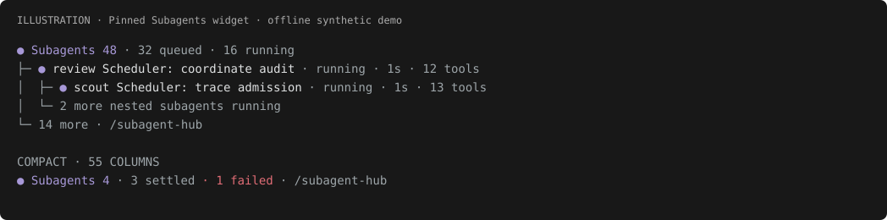
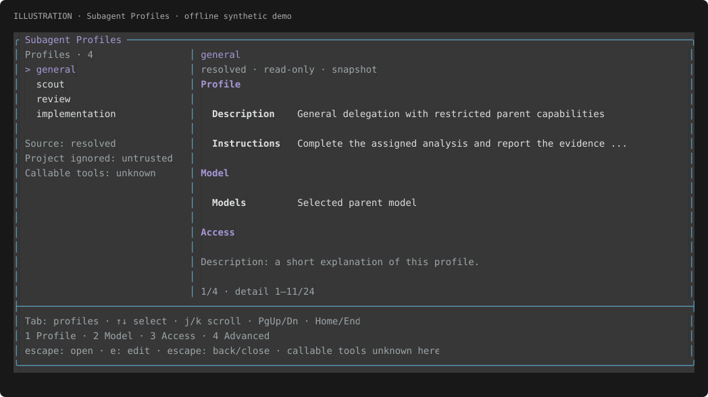
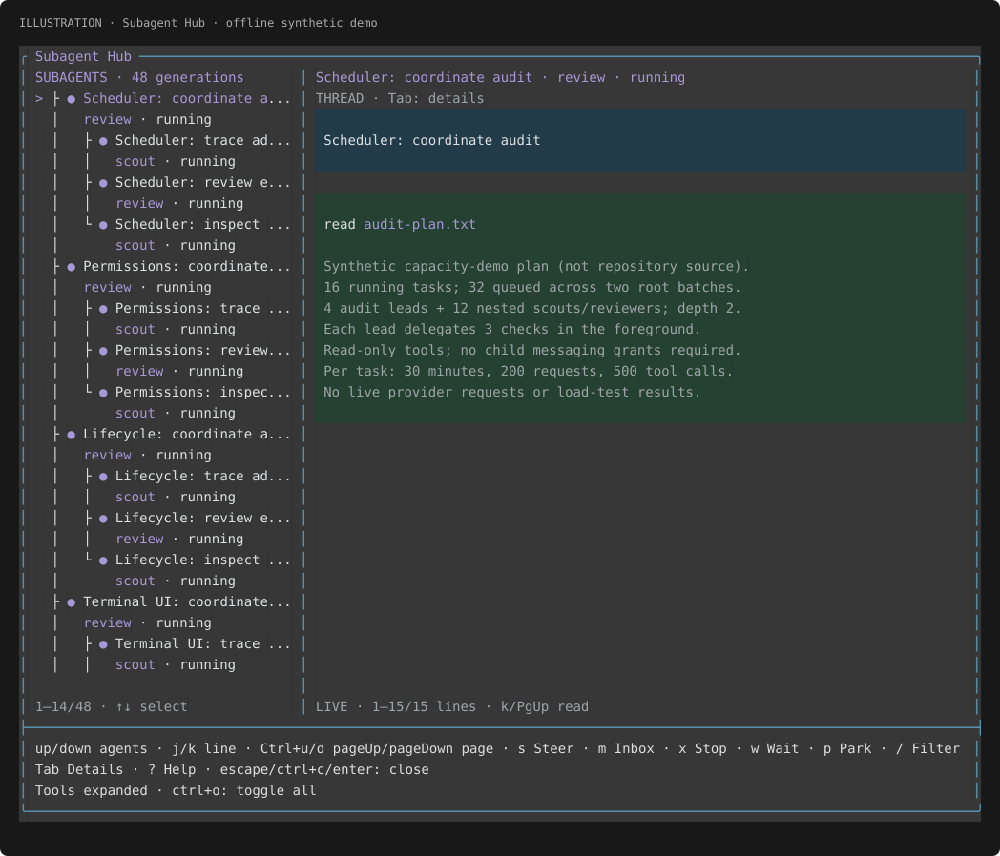

# @howarewoo/pi-subagents — Pi subagent extension

[](https://www.npmjs.com/package/@howarewoo/pi-subagents)
[](https://www.npmjs.com/package/@howarewoo/pi-subagents)

Delegate code exploration, reviews and implementation tasks in the [Pi coding agent](https://pi.dev). Follow each subagent's conversation and tool use, then steer or stop tasks from [Subagent Hub](#subagent-hub). Subagents use your selected physical model by default, or an independently configured profile chain, with their own assignments and explicit tool grants.

Use this extension to supervise delegated work inside a running Pi session. Keep the parent running until tasks finish; writers run concurrently by default, and you coordinate shared writes and any worktrees. See [why choose this repo](#why-choose-this-repo) and the [feature comparison](#feature-comparison) for the full trade-offs.

[Install](#installation) · [Quick start](#quick-start) · [Subagent Hub](#subagent-hub) · [Compare extensions](#feature-comparison) · [Documentation](#documentation)



_Pinned Subagents widget at default capacity: 16 running tasks and 32 queued. Below it, a separate 55-column example shows the failure count and `/subagent-hub` even when no tasks are running. Synthetic demo data, not a live load test._

## Installation

Requires **Node 22.19+** and **stable Pi 1.5.2 or newer**. Tested host: Pi 1.5.2;
newer stable versions are allowed, not guaranteed compatible. Prerelease, older, malformed
and unknown host versions are rejected before task reads, allocation or model requests.
Wildcard host peer dependencies follow Pi's package format, not a compatibility promise.
See [host support](docs/delegation-contract.md#supported-host) for version rules.

If the host is unsupported, let active tasks drain, update Pi and restart. Status,
stop/cleanup and diagnostics remain available where the extension can load; arbitrary
older SDKs may fail at module load. The minimum-host restriction is a breaking change
in 0.2.0. When upgrading from 0.1.x, drain active tasks, install stable Pi 1.5.2 or newer,
update the extension and restart Pi.

Install from npm:

```sh
pi install npm:@howarewoo/pi-subagents
```

Alternatively, install from Git with `pi install git:github.com/howarewoo/pi-subagents`.
Use only one source: when switching between npm, Git or a local checkout, remove the
previously registered source first so Pi does not load the extension twice.

Restart Pi and run `/subagent-profiles` to check the installation.

### Migrate from the old package

If you installed the former unscoped package, follow the
[0.1.1 migration instructions](CHANGELOG.md#011) before installing the current package.

## Quick start

Start Pi in a project containing a `README.md` file. Choose a model through Pi's `/login` and `/model` setup. Delegation uses that provider and may incur charges; it does not automatically switch to a cheaper model.

Ask Pi:

> Use delegate_task with profile scout to read README.md and summarize this project's purpose in three bullets. Run it in the foreground.

The corresponding tool call is:

```json
{
  "assignment": "Read README.md and summarize this project's purpose in three bullets",
  "profile": "scout",
  "background": false
}
```

The foreground call returns the scout's summary to the parent. Open `/subagent-hub` to inspect its conversation and tool calls. This example needs only the `read` tool; it does not require enabling `grep`, `find`, `ls` or `bash`.

## Use delegation

Submit a batch for parallel read-only work:

```json
{
  "tasks": [
    { "assignment": "Locate startup code", "profile": "scout" },
    { "assignment": "Review lifecycle tests", "profile": "review", "limits": { "requests": 20 } }
  ],
  "background": false
}
```

The default is 16 concurrent tasks, a 32-item queue and up to 16 tasks per batch. Every item passes preflight before any starts. One failed task does not cancel its siblings.

`scout` and `review` allow up to `read`, `grep`, `find` and `ls`. `general` and `implementation` also allow `write`, `edit` and `bash`. Each role receives only the builtins already callable in the parent. With Pi's default tools, scouts get `read` only. Tool calls retain the parent's permission hooks; incompatible tool overrides are rejected.

`general` inherits available parent skills, not parent instructions or history. Its role prompt and assignment remain intact. Operator/trusted-project `tools` and `skills` settings can narrow inheritance; `[]` removes grants. General can write when its effective tool set allows it.

**Extension/MCP tools require operator review.** Set `general.leafTools` to exact names only for trusted tools that never call other Pi tools or change the tool/model/session loadout. Descriptions and annotations do not grant trust. Orchestrating/reaching tools, codemode, tool search, owned controls, hidden/model-only tools and builtin replacements cannot be forwarded. Leaf tools require the root workspace; only builtins support cwd adaptation. See [restricted inheritance](docs/delegation-contract.md#restricted-general-inheritance).

Foreground calls return the final results. Set `background:true` to return immediately and receive one ordered completion message after the batch actually drains, automatically waking the owning parent (or queuing a follow-up if busy).
Direct `delegate_coordinate resume/followup/revive` and `subagent resume` likewise send one
wake-enabled outcome per new execution window; followup/revive identify the new generation.
Foreground calls add no extra notice; rejected calls add none. Paused, failed and cancelled
outcomes notify too, but do not authorize automatic resume. A wake requests a model turn,
not guaranteed task continuation. All notices remain parent-bound and are suppressed on
shutdown/reload; no polling or forced continuation loop is added.

**0.4.0 migration (breaking behavior):** native background/direct resume now wake the parent,
and followup/revive now notify and wake. This can add parent model turns and provider costs.
Drain active tasks, install `npm:@howarewoo/pi-subagents@0.4.0`, then restart Pi. Grants,
configuration and the stable Pi 1.5.2 minimum/tested host are unchanged. Updating a checkout
does not repair an already loaded runtime. See the [delegation contract](docs/delegation-contract.md).

Use the returned task ID and generation for controls:

```text
/subagent-profiles
/subagent-status
/subagent-status <id> <generation>
/subagent-steer <id> <generation> <text>
/subagent-stop <id> <generation>
/subagent-hub
```

## Native orchestration

Pi discovers the native `subagent` tool at startup through its tool description and coding-worker guidance; no enable call is needed. For replacement use, load only one extension providing `subagent`: Pi uses the first registration, not an automatic provider preference. Switching providers does not migrate or remove old runs.

```json
{
  "agent": "worker",
  "task": "Implement the approved change; follow the supplied repository guidelines and task references",
  "cwd": "/absolute/path/to/task-worktree"
}
```

- `worker` maps to the configured `implementation` profile; `scout`, `review` and `general` are also available.
- Calls are async by default and wake the parent after drain. Set `async:false` to wait; use `tasks:[{agent,task,cwd?}]` for a batch.
- Control a task with its returned `id` and `action:"status"`, `"steer"`, `"stop"` or `"resume"`. Steer/resume also require `message`.
- Resume continues a drained paused **or completed** conversation, preserving the same identity, generation, session count and full SDK conversation/tool history. Completed idle/parked agents restore their canonical session into a new SDK runtime using the same transcript, not a result summary. Missing restoration state, stopped identities, failed identities without an operator fallback reset, and retired descendants reject; there is no fresh-context fallback. Explicit `delegate_coordinate` followup/revive still start fresh work.

The coordinator supplies an existing workspace and the complete handoff, including accessible skill/reference paths. The extension does not create or manage worktrees. This is the [supported orchestration interface](docs/delegation-contract.md#native-orchestration-compatibility), not compatibility with every competing workflow script or ambient Markdown agent definition.

## Subagent Profiles

Run `/subagent-profiles` to inspect bundled, global operator and trusted-project profiles. The read-only Inspector is the landing view: a profile rail beside a spaced label/value overview, with complete setting details, provenance and configuration paths available on demand; **no write destination is selected automatically**.

1. Select a role with ↑/↓. Tab switches focus between profiles and settings; 1–4 jump to **Profile**, **Model**, **Access** and **Advanced** in the overview. Enter (or the configured confirm key) opens the selected setting read-only; Escape returns to its overview row. Narrow screens keep a compact selected-role strip above settings. Press `e` to edit, then choose **Global operator settings** or **Trusted project settings**, checking the exact path. Project editing is unavailable until the host already trusts the workspace; the editor never changes trust.
2. Open **Description** or **Instructions**, then select its edit control to use native input. Ctrl+Left stays native word navigation; it never saves or leaves text input. Commit a description with Enter or by tabbing back to the profile rail (once only). Submit multiline instructions with the native editor; Tab instead keeps a changed buffer as an **unsaved draft** and focuses profiles. Browse another profile, then select **Resume Global general.prompt draft** (for example) to return to the original buffer and caret. Reopening its field also resumes it. Escape while editing explicitly cancels only that active buffer, not other drafts or accepted saves. Opening unchanged text creates no draft. Each committed action autosaves in order, without Apply/Cancel or ordinary file review. Pending badges and **Saving / Pending** values are distinct from **Saved · verified** and unsaved drafts. The destination and exact path stay pinned across profile changes.
3. Open **Tools**, **Skills** or General’s **Reviewed tools** to inspect complete entries. On `[x]` / `[ ]` membership rows, Space or the configured confirmation key toggles once and saves immediately; arrow movement only selects. Space is not an action on model-navigation, reset/revoke or disabled rows. **Delegation** groups **Spawn targets (spawn)** and **Coordination (coordination)** separately. Overview counts are ceilings; inherited and explicit-empty declarations remain distinct in details. Exact skill/leaf additions use native text input; removing the last member stores `[]`, while **Reset … to inherited** removes the layer key. These are ceilings, not proof that tools are callable. Within settings, ↑/↓ selects controls, Enter activates, j/k and PgUp/PgDn scroll, and Home/End selects the first/last control. Text and catalog search retain printable Space, j/k and `?`. Focused hints distinguish opening, editing, immediate saves, reset/revoke, disabled controls and structural review; native text submission uses its own binding, not the selection-confirm binding. Narrow screens stack the profile selector; tiny/short screens request resize without activating hidden controls.
4. Open **Models** for one ordered list: the first entry is **Default**, followed by **Fallback 1**, **Fallback 2**, and so on. Moving or removing the first entry makes the next first entry the default for the chain. Open a target to reveal its exact provider/ID/effort and Earlier/Later, effort and removal controls; other targets’ controls stay hidden. For a new target choose **Add to chain / Add and grant**, browse friendly names/custom providers, optionally search names/providers/IDs, choose a supported effort, then **Add and grant / add to chain**. Global additions atomically save routing and any needed exact grant, without a modal. **Global affects other workspaces, and grants also permit explicit overrides—not only fallback.** Selected-target moves/removals save immediately; removing the final target saves `fallback:false` and keeps grants. The resulting unchained model/parent route may still be denied by current permissions. Resetting inheritance is a separate action. Effort changes retain the old grant. Project can only keep/remove an authorized ordered subsequence; change destination explicitly to Global for restricted actions. Prewalk/chain changes require the labeled compound switch, never hidden cleanup.
5. In the catalog, press ↑/↓ directly from Search to focus the first result, then use ↑/↓ to browse and Enter to proceed to explicit effort selection. No exact ID or Tab is needed to start browsing. Tab still cycles search, provider, models, effort, selection and Refresh; ←/→ filters providers or chooses effort. Models with no eligible effort are hidden. When space allows, a note below results summarizes the reasons; compact layouts show a hidden count and keep the full matching identities/reasons in **F1** details instead of crowding out eligible results. Models with at least one eligible effort remain selectable; their disabled efforts remain inspectable. **F1** opens scrollable exact-ID, supported-effort and hidden-reason details; F1/Escape returns without accepting a selection. **Refresh metadata** only rereads the host snapshot, never network/provider caches. Unavailable saved selections stay warning rows and do not block unrelated edits/removal/reorder. New selections are rechecked on confirmation and when their queued action executes. Unchained model/prewalk and standalone grants also autosave; a grant needed by routing cannot be removed until routing is adjusted.
6. Open **Advanced** for prewalk policy, exact model grants, raw/inherited/effective diagnostics, custom create/copy/delete, whole-override reset, local ceilings and operator authorization/registration. While a chain is active, its default is edited only through the first entry in **Models**, not a separate Advanced default control. Without a chain, Advanced retains the unchained model control. Existing `model` settings and runtime bypass/disable behavior are unchanged; editing the chain does not rewrite the unchained setting, which remains inspectable in source diagnostics. Structural operations first finish ordinary saves, then retain explicit transaction review/save and confirmations. Blank definitions start with empty grants. A copy is independent, not live inheritance; copying `general` excludes automatic skill inheritance/leaf forwarding and requires explicit review of copied skill paths. For a Project-local role, first authorize named global ceilings, then choose one during trusted-Project creation. This authority is not a spawn grant. Returning from a structural transaction rereads current configuration before ordinary editing resumes. Merely opening/closing Advanced or other settings never saves or grants anything. Escape first cancels unfinished native input, then returns through setting/target details to the overview; outer close finishes accepted saves.

The profile/model flow is sized for a physical **80×24** terminal (72×21 production overlay; the nested catalog has 68×14). Focus entering settings follows the selected label, not its full value or trailing spacer. In **Advanced → Exact model grants**, select a numbered **Remove grant** row and use j/k or paging to read its full exact provider/ID/effort and warning. Confirming revokes only that grant, and remains disabled while routing requires it. A clipped value or warning does not disable a visible label; a genuinely hidden label still cannot activate. Below baseline, resize messages retain local back/cancel without saving or dispatching hidden controls; grow the terminal to continue from the same selection.

Reset removes only the selected-layer override. Delete removes a custom definition and blocks on local configuration references and nonterminal/reusable tasks; references must be removed explicitly and tasks stopped/drained using existing controls. It does not scan other workspaces or mutate history. See the [configuration and persistence contract](docs/delegation-contract.md#custom-definitions-and-project-role-ceilings).

On a known pre-replacement failure, **Not saved** retains the attempted action and freezes later mutations. Any unrelated unfinished text—including an exact-entry input—is retained separately as a named draft. Browse profiles and Resume text while paused, but submission/blur cannot enqueue it. **Retry** retries the same accepted action; **Revert** discards the disclosed number of unsaved actions. Both retain unsubmitted drafts and previously verified saves; neither submits drafts automatically. After recovery, explicitly Resume and submit a draft when ready.

A relevant external edit, any trust change, or completed/unknown replacement requires **Reload**, which abandons the whole unsaved tail without merge, replay, force-write or rollback. If drafts exist, Reload identifies their destination/profile/field and discloses both draft and queued-change counts before an explicit discard-and-continue decision. The default **Keep drafts and return** (or Escape) abandons neither. Only currently trusted Project layers are read. Malformed Reload leaves an explanatory read-only state that can be closed; confirmed discards remain discarded even if reopening fails.

Close, destination changes, structural Advanced actions and resetting/replacing a drafted field likewise ask you to keep drafts or explicitly discard affected text. Ordinary profile browsing and unrelated toggles do not. Once draft disposition is resolved, close/destination/structural navigation shows **Finishing saves** and navigates only after every accepted action verifies. Any failure cancels that navigation; Retry cannot unexpectedly close the Inspector. Drafts are in memory for this Inspector only, not saved on disk. Force-quitting the process can lose queued/unfinished input; there is no durable recovery journal. At the physical 80×24 baseline (72×21 overlay), draft/exit controls remain available. Smaller terminals may request resize; resize itself never discards, and Escape's local hint distinguishes cancelling active text from keeping suspended drafts. The existing external-writer race between final check and rename is not eliminated by the in-memory FIFO.

Saved instructions apply to new sessions, not retained prompt/history replacement. Grant revocations can deny later runtime operations; admitted tasks never gain new authority from an edit. No agent restarts automatically. Reopen the viewer to refresh an externally changed snapshot.

To enable **nested project-local targets**, explicitly register an exact name and required ceiling in **Register project-local spawn targets** under Advanced in Global. Review/save this structural authorization, then separately toggle the name in the parent's **Delegation → Spawn targets (spawn)** membership list; that item autosaves. A trusted project must define that exact name with the exact registered ceiling. Registered-but-absent names are conditional choices, not profiles or discovery placeholders, and cannot launch until the local definition exists.

**Registration scope is every trusted project using these operator settings**, not only the current workspace. Each trusted project may supply independent instructions for the registered name under its ceiling. Registration is neither a parent spawn grant nor authorization for every role under a ceiling. Root local launches do not require incoming registration. See the [exact paired configuration](docs/delegation-contract.md#custom-definitions-and-project-role-ceilings).

**Ceilings are not callable tools.** Pi's command context has no callable-tool dispatcher, so the viewer/editor report callable tools as unknown rather than treating active declarations as executable grants. Admission performs the real intersection and remaining checks; inspect a task's `tools` in `/subagent-status` or Hub Details. RPC, JSON and print modes retain the structured `{toolPolicy, profiles}` message instead of opening an overlay. Invalid configuration or missing/invalid granted skills fails resolution, as at admission.



_Synthetic native-component output; not a terminal screenshot or live-provider verification. Regenerate with `node scripts/render-hub-hero.ts --profiles`._

## Subagent Hub

Subagent Hub shows the task list beside the selected conversation using Pi's native renderers. On narrow terminals, the conversation takes the full width. Details shows results, artifacts, grants and usage; Tools shows full sanitized arguments and result text.

The thread follows new output until you scroll up. Press End to follow again. The pinned Subagents widget appears after the first task starts. Compact summaries retain explicit failed counts, distinct from settled or cancelled tasks without relying on color. Summary-only fleets include a `/subagent-hub` hint within the widget's existing row budget at practical widths (for example, 55 columns). Closing Subagent Hub does not stop the work.

The Hub and widget illustrations use native renderer output with a synthetic fleet filling the default 16 concurrent slots and 32-item queue. Four read-only audit leads each have three foreground descendants, reaching the default nesting depth of two. The queue represents two further 16-task root batches, not one oversized batch. These are illustrations, not terminal screenshots or live-provider stress-test evidence. Regenerate them with `node scripts/render-hub-hero.ts` and `node scripts/render-hub-hero.ts --widget`.



_Subagent Hub at default capacity: tasks and conversations side by side, with nested scouts/reviewers at depth two. The roster scrolls through all 48 tasks._

| Key                   | Action                                                                      |
| --------------------- | --------------------------------------------------------------------------- |
| ↑ / ↓                 | Select a subagent or historical generation                                  |
| j / k                 | Scroll down / up one line                                                   |
| Ctrl+u/d or PgUp/PgDn | Scroll a page                                                               |
| Home / End            | Top / latest output                                                         |
| Tab                   | Switch between thread, details and tools                                    |
| /                     | Filter the subagent list                                                    |
| s / m                 | Steer / send an inbox message                                               |
| x, then y             | Stop the selected subtree; Enter does not confirm                           |
| w / p                 | Wait briefly for an outcome / park an idle task                             |
| ?                     | Open browse help; ? or cancel returns to the same view and reading position |
| Enter                 | Close the Hub in browse mode; send/apply in input                           |
| Esc / Ctrl+C          | Cancel input, return from help, or close the Hub                            |

These are the default keys. The footer names the next Tab view and all configured confirm/cancel browse-close bindings. Tool expansion uses the configured `app.tools.expand` keys (default Ctrl+O), with its current expanded/collapsed state shown in the thread footer; unbound actions have no fallback key. Browse `?` opens observation-only, scrollable help that blocks underlying controls. In filter/steer/inbox inputs, printable `?`, j/k and Space remain text. Stop still requires **y**, never Enter.

Mouse-wheel scrolling works in fullscreen mode. In regular mode, use the keyboard controls because the terminal owns mouse scrollback. Actions and pending/success/error notices identify the original task UUID, generation and task label even after selecting another task or filtering it out. Controls refuse to submit if the window cannot show the full target. A stopped-and-drained notice appears only after drain completes; inbox receipt state and queued/handled steering are not model acknowledgment. Navigation, help, resize and closing do not dispatch task controls.

## Messages and follow-up work

Use `delegate_coordinate` to message a running subagent, wait for an outcome or assign follow-up work. Include it in any explicit tool allowlist alongside `delegate_task`.

```json
{"action":"message","target":{"id":"<task-id>","generation":1},"text":"Check the shutdown path too","mode":"steer"}
{"action":"wait","target":{"id":"<task-id>","generation":1},"timeoutMs":30000}
{"action":"followup","target":{"id":"<task-id>","generation":1},"assignment":"Now review the cancellation path"}
```

Each line is a separate call. An accepted or queued message is not a delivery confirmation; even a delivered receipt does not prove the model understood it. Follow-ups start a new generation without replaying the old conversation, so include the context it needs. Follow-up and revival are model-tool operations, unavailable directly in Subagent Hub. Child messaging is off until explicitly granted. See the [coordination reference](docs/delegation-contract.md#live-parent-messaging-waits-and-presence).

### Task files and structured results

Use `taskFile` instead of `assignment` to read instructions from a workspace-relative text file. Add `resultSchema` when you need a validated JSON value:

```json
{
  "taskFile": "tasks/review.txt",
  "profile": "review",
  "resultSchema": {
    "type": "object",
    "properties": { "summary": { "type": "string" } },
    "required": ["summary"],
    "additionalProperties": false
  }
}
```

Task files must be regular UTF-8 files of 1 to 50000 bytes, outside hidden paths and `node_modules`. Reads use the parent's permission hooks. Schema-required children call `submit_result({value:...})`; missing or invalid results fail visibly. See [supported schemas](docs/delegation-contract.md#required-structured-results) and [task-file checks](docs/delegation-contract.md#checked-task-file-input).

## Configuration

No configuration is needed for the bundled roles. To change prompts or narrow tools, use `~/.pi/agent/delegation.json`:

```json
{
  "review": {
    "tools": ["read", "grep"],
    "skills": ["/absolute/operator-reviewed/review/SKILL.md"],
    "prompt": "Review this assignment and report concrete findings with source locations."
  }
}
```

All bundled profiles may delegate to `scout` and `review` by default, within a total depth of two (root 0, child 1, grandchild 2). Other nested targets and child messaging need explicit operator grants. Set `spawn: []` to revoke nesting. General inherits available parent skills; other roles need explicit skill grants. Trusted project configuration in `.pi/delegation.json` can narrow grants, never expand them. Children do not load ambient extension/MCP runtimes or context files; general can forward only the reviewed leaf tools described above.

### Profile-owned model chains

Configure `models` as permission grants and a separate ordered `fallback` array on a profile
in `delegation.json`. The chain starts at its own first available authorized physical target,
regardless of the parent's model, including when the parent selects a virtual model. It never
executes or inherits that parent's router. Profiles without a chain keep existing routing.

Each failed eligible request gets two same-model retries before advancing. Transient outages
and exhausted quota/credits are eligible; authentication, permission, invalid requests,
refusals, tool failures and cancellation are not. Backups remain selected across explicit
resume until operator reset. Every attempt consumes the same cumulative request budget;
backoff consumes the current deadline window.

An explicit task `model` stays pinned unless `fallback:true` opts into that model's suffix of
the profile chain. `fallback:false` disables chaining. Task `models` can remove destinations,
not add or reorder them. Fallback and prewalk cannot be combined. Listing a provider in a
chain authorizes sending that child's conversation to it; failed calls may still cost money.

Inspect `/subagent-status <task-id> <generation>`. To reset an idle/paused retained child,
use `/subagent-fallback-reset <task-id> <generation>`. Reset sends no request and replenishes
no budgets or deadline. An exhausted failed child requires this operator action before
explicit resume; model-facing tools cannot reset routing. No state survives parent shutdown.
See [configuration, safety and diagnostics](docs/advanced-policies.md#profile-owned-fallback-chains).

Default task limits are **30 minutes**, **200 direct model requests** and **500 tool calls**:

- These are hard caps. Before reaching them, a subagent can use reserved capacity to report partial findings or submit a structured result instead of starting new work. Wrap-up does not add capacity or guarantee a result. Trusted project and per-task limits can still only narrow the applicable budgets.
- A deadline pauses the active subtree after tool/provider drain, releasing capacity but retaining sessions and conversations.
- Use `subagent` resume or root-only `delegate_coordinate` `{action:"resume",target:{id,generation},assignment:"Continue…"}` to continue the same identity and conversation. Only the deadline resets; request/tool/spawn counters remain cumulative (at most 64 windows per generation). Completed windows retain earlier result/artifact evidence in `completedWindows`; a resumed completed structured assignment requires a new `submit_result`.
- Resume the parent first, then explicitly selected children. Descendants never resume automatically.
- Stop, shutdown and hard request/tool limits cancel and dispose. Unresponsive code must drain before pause or cancellation can release resources.

See [limits and nesting](docs/delegation-contract.md#capacity-and-bounded-execution), [profile grants](docs/delegation-contract.md#subagent-profiles-and-explicit-spawn-grants), and [model selection and prewalk](docs/advanced-policies.md).

## Shared checkout and lifetime

Subagents use your checkout unless you supply an existing directory as `cwd`. Parent permission hooks still apply and may deny access. **Writers and parent tools may run together**, bounded by ordinary FIFO capacity. Workspace selection is not a sandbox. Coordinate shared writes, including manual commands, external editors and other sessions. See [workspace safety](#why-workspaces-are-caller-managed-and-writes-are-caller-coordinated).

Keep the parent runtime alive until work finishes. Shutdown or reload aborts and drains children; there is no restart recovery or cross-parent revival. Saved transcripts and results may contain sensitive task, tool and model output; protect them like your main Pi transcripts.

### Why worktrees are managed externally

Create or select a workspace externally, then pass `cwd` as in the
[native orchestration example](#native-orchestration). The caller owns it throughout the
assignment, including inspection, integration and removal. Automatic worktree creation,
commits, apply and cleanup are intentionally outside scope, not planned features.

Separate worktrees do not isolate shared external resources or provide a sandbox.
See [workspace ownership and writer coordination](#why-workspaces-are-caller-managed-and-writes-are-caller-coordinated).

### Why workflows and scheduling stay external

Separate packages can compose the public delegation tools and own when and how to run
assignments within the parent runtime. This does not grant automatic tool/context
inheritance or promise compatibility with existing third-party workflow packages.
See [orchestration boundaries](#why-orchestration-stays-with-the-caller).

## Updates and rollback

Let active subagents finish before updating, then restart Pi. Shutdown or `/reload` aborts
and drains children; active tasks are not migrated to the new version. There is no extension-owned
auto-updater.

```sh
# Update an unpinned npm installation
pi update npm:@howarewoo/pi-subagents

# Or update all installed extension packages
pi update --extensions
```

Plain `pi update` updates Pi itself, not installed extension packages. For a Git installation,
use `pi update git:github.com/howarewoo/pi-subagents`, matching the source you registered.
An unpinned Git source tracks the repository's default branch, including unreleased commits.

For a reproducible npm installation or rollback, select an exact published version:

```sh
pi install npm:@howarewoo/pi-subagents@0.2.0
```

For Git, select a published tag, for example
`pi install git:github.com/howarewoo/pi-subagents@v0.2.0`.
Exact npm versions and Git tags stay pinned; updating does not advance them to the next release.
Install a different version explicitly to change the pin.

[CHANGELOG.md](CHANGELOG.md) lists user-facing changes and migrations. Pi shows new package
changelog entries on the next fresh launch after a version increase. See the
[maintainer release guide](docs/releases.md) for publishing and recovery.

## Feature comparison

Compared with three community alternatives using their documentation. Nicobailon and tintinweb were checked on 2026-11-11; tintinweb's messaging scope was additionally checked against source at revision `b72b414` (2026-11-12). `pi-better-subagents` was checked against its published 0.32.4 documentation on 2026-11-13. This is a feature comparison, not a performance or reliability benchmark. UI cells name documented surfaces; they do not imply other features are absent.

| Feature                        | @howarewoo/pi-subagents                                                                                                  | [nicobailon/pi-subagents](https://github.com/nicobailon/pi-subagents)                                                                                                                            | [tintinweb/pi-subagents](https://github.com/tintinweb/pi-subagents)                                                                                                                                                    | [pi-better-subagents](https://pi.dev/packages/pi-better-subagents)                     |
| ------------------------------ | ------------------------------------------------------------------------------------------------------------------------ | ------------------------------------------------------------------------------------------------------------------------------------------------------------------------------------------------ | ---------------------------------------------------------------------------------------------------------------------------------------------------------------------------------------------------------------------- | -------------------------------------------------------------------------------------- |
| Background tasks               | ✅ [Parent-bound by design; until exit or reload](#why-background-tasks-are-parent-bound)                                | ✅ Supported                                                                                                                                                                                     | ✅ Supported                                                                                                                                                                                                           | ✅ Non-blocking `pi -p` child processes; completion callbacks                          |
| Nested delegation              | ✅ [Supported](#why-nested-delegation-is-foreground-only)                                                                | ✅ Supported                                                                                                                                                                                     | ✅ Supported                                                                                                                                                                                                           | ⚠️ Opt-in for unconfined children; disabled in sandbox                                 |
| Task list / conversation       | ✅ [Subagent Hub: split panes; full-width thread on narrow terminals](#why-the-ui-observes-one-native-registry)          | ✅ Fleet inspector: roster and output pane                                                                                                                                                       | ✅ FleetView opens a separate conversation viewer                                                                                                                                                                      | ✅ Background-work navigator; output/result tools                                      |
| Message / tool rendering       | ✅ [Native Pi message and tool components](#why-the-ui-observes-one-native-registry)                                     | ✅ Structured Markdown/tool transcripts                                                                                                                                                          | ✅ Markdown + session-registered tool renderers                                                                                                                                                                        | — Not assessed                                                                         |
| Bi-directional agent messaging | ✅ [Supported; parent/child and siblings](#why-agent-messaging-is-family-scoped)                                         | ⚠️ [Child/supervisor requests and replies](https://github.com/nicobailon/pi-subagents/blob/c99503aed6d6b20d2397a1767f7d60730efe3963/docs/workflows.md#supervisor-coordination-child-asks-parent) | ⚠️ [Parent-to-child steering + result return; no built-in child-initiated or sibling messaging](https://github.com/tintinweb/pi-subagents/blob/b72b414581d8aa9bbfb1d44c832aed0d0b0b9053/src/nested-tools.ts#L400-L430) | ⚠️ Parent-to-child communication + result return; no blocking child-to-parent requests |
| Live follow / scrollback       | ✅ Scroll up to pause; End to follow                                                                                     | ✅ Scroll away to pause; bottom resumes                                                                                                                                                          | ✅ Scroll up to pause; End to follow                                                                                                                                                                                   | — Not assessed                                                                         |
| In-UI task controls            | ✅ [Hub: steer, inbox, stop, wait, park](#why-controls-are-identity-pinned)                                              | ✅ Inspector: steer/follow-up and stop async runs                                                                                                                                                | ✅ Viewer: steer, stop, foreground-to-background handoff                                                                                                                                                               | ✅ Navigator stop controls                                                             |
| Tool / usage inspection        | ✅ [Tools: sanitized arguments/results; Details: direct usage](#why-the-ui-observes-one-native-registry)                 | ✅ Expandable tool details + token counts                                                                                                                                                        | ✅ Expandable tool output + tokens; optional cost                                                                                                                                                                      | ✅ Output/result tools expose optional cost and tool counts                            |
| Schema-validated results       | ✅ [Supported](#why-structured-results-require-explicit-submission)                                                      | ✅ Supported                                                                                                                                                                                     | ⚠️ Workflow agents only                                                                                                                                                                                                | — No equivalent caller-supplied result schema documented                               |
| Managed Git worktrees          | 🚫 [By design; caller-managed worktrees supported](#why-workspaces-are-caller-managed-and-writes-are-caller-coordinated) | ✅ Supported                                                                                                                                                                                     | ✅ Supported                                                                                                                                                                                                           | ⚠️ Optional self-contained Git clone; not managed linked worktrees                     |
| Workflow scripts               | 🚫 [By design; caller-owned](#why-orchestration-stays-with-the-caller)                                                   | ✅ Supported                                                                                                                                                                                     | ✅ Supported                                                                                                                                                                                                           | — Not assessed                                                                         |
| Scheduled runs                 | 🚫 [By design; no scheduler](#why-orchestration-stays-with-the-caller)                                                   | ✅ Supported                                                                                                                                                                                     | ⚠️ Session-scoped agents only                                                                                                                                                                                          | — Not assessed                                                                         |

Legend: ✅ Supported (stated design boundaries apply) · ⚠️ Supported with scope restrictions · 🚫 By design · — Not established by the cited documentation or not assessed.

🚫 marks a deliberate product boundary, not a missing implementation within the current
contract. Linked explanations describe the trade-offs behind this repo's choices.

Sources: [our contract](docs/delegation-contract.md); nicobailon's [README](https://github.com/nicobailon/pi-subagents/blob/c99503aed6d6b20d2397a1767f7d60730efe3963/README.md), [agents](https://github.com/nicobailon/pi-subagents/blob/c99503aed6d6b20d2397a1767f7d60730efe3963/docs/agents.md), [workflows](https://github.com/nicobailon/pi-subagents/blob/c99503aed6d6b20d2397a1767f7d60730efe3963/docs/workflows.md) and [observability](https://github.com/nicobailon/pi-subagents/blob/c99503aed6d6b20d2397a1767f7d60730efe3963/docs/observability.md); tintinweb's [README](https://github.com/tintinweb/pi-subagents/blob/8df7fa7d8e8130151a8fbfa991a1d3fa6b443739/README.md) and [workflows](https://github.com/tintinweb/pi-subagents/blob/8df7fa7d8e8130151a8fbfa991a1d3fa6b443739/docs/workflows.md); pi-better-subagents' [usage guide (0.32.4)](https://cdn.jsdelivr.net/npm/pi-better-subagents@0.32.4/docs/usage.md) and [agent catalog (0.32.4)](https://cdn.jsdelivr.net/npm/pi-better-subagents@0.32.4/docs/agent-catalog.md).

### Why choose this repo?

Choose this repo for a supervised workflow in an existing checkout:

- Child tools retain parent permission hooks. Profiles cap authority; trusted-project
  settings and tasks can only narrow operator grants. Ambient extension/MCP runtimes
  are not loaded, and extra leaf tools require operator review.
  See [permissions and resources](#why-permissions-and-resources-are-explicit).
- Children use the parent's physical model and effort unless an exact operator-approved override
  or profile-owned fallback chain applies. Unchained unavailable selections fail without fallback.
  See [model routing](#why-model-routing-is-exact).
- `resultSchema` requires explicit, validated submission. Batches pass preflight before
  any child starts, retain input order and report background outcomes after all siblings
  drain. See [structured results](#why-structured-results-require-explicit-submission).
- Hub combines native Pi conversations, tool arguments/results, usage and identity-pinned
  controls. Granted parent/child and sibling messaging stays bounded within the live
  parent runtime. See [Hub](#subagent-hub) and [messaging](#why-agent-messaging-is-family-scoped).
- Writers and parent tools may run concurrently in the same checkout, within ordinary
  FIFO capacity. Assign independent responsibilities and coordinate shared operations;
  the extension does not prevent collisions, lost updates or Git index contention.
  See [workspace ownership](#why-workspaces-are-caller-managed-and-writes-are-caller-coordinated).

#### Compared with nicobailon/pi-subagents

This repo keeps background assignments under one live parent responsible for grants,
admission, descendant drain and bounded concurrency. Nicobailon also runs foreground
children in-process, but uses a detached background runner. Both have fleet inspection
and schema-validated results.

Choose nicobailon for packaged review loops, council patterns, custom agents with
per-agent memory, managed worktrees, durable missions or scheduled runs. This repo
leaves workflows and workspace lifecycle to the caller, with no scheduler or restart
recovery.

#### Compared with tintinweb/pi-subagents

This repo supports granted parent/child and sibling messaging, plus schema-validated
results on ordinary assignments. Tintinweb's cited implementation has parent-to-child
steering and result return; its schema-validated results are documented for workflow
agents. This repo's Hub keeps the roster beside the conversation on wide terminals;
tintinweb's FleetView opens a separate viewer.

Choose tintinweb for Claude Code-style tool conventions, compatible JavaScript workflows,
persistent agent memory, session-scoped scheduling or managed worktrees that preserve
changes on a branch. Both support conversation continuation, but this repo retains it
only within the owning parent runtime; tintinweb documents persisted resume. Its worktree
isolation is not an OS sandbox.

#### Compared with pi-better-subagents

This repo supports foreground results or background completion, live family messaging
and explicitly submitted schema-validated results. `pi-better-subagents` uses independent,
non-blocking child processes with completion callbacks and no mid-task blocking
child-to-parent requests.

Choose `pi-better-subagents` for opt-in macOS/Linux sandboxing (off by default), saved
conversations another foreground session can continue, or optional sandbox-oriented Git
clones. This repo has no OS sandbox; changing `cwd` does not provide containment.
The other package also has an editable role/named-agent catalog and, with Background
Tasks loaded and its documented prerequisites met, workers that release slots while
waiting for long operations.

Recommendations apply to the cited versions, without a performance or reliability ranking.
Unassessed controls may exist in the alternatives.

## Architectural decisions

These choices define the current execution contract and its trade-offs. They are not
claims that other designs are unsafe or impossible. Deferred capabilities are identified
separately; an unsupported feature is not automatically a permanent exclusion.

### Why background tasks are parent-bound

Background tasks belong to the live parent Pi runtime. Shutdown or `/reload` cancels
children and drains their tools and descendants before releasing capacity.
Closing Subagent Hub does not stop work. Stopping tasks retain their permits until
actual drain, while unrelated siblings may continue within available capacity.

Keep Pi running until tasks finish: there is no detached runner or restart recovery.
Unresponsive provider, permission or tool code can delay drain; abrupt process death
cannot guarantee cleanup. Saved transcripts are inspection records, not restart state.

In the cited versions, nicobailon uses detached background processes. Tintinweb stops
agents on shutdown but supports persisted conversation resume and foreground-to-background
handoff. Persisted conversations do not keep jobs running after exit.
See [the delegation contract](docs/delegation-contract.md) for continuation semantics.

### Why nested delegation is foreground-only

Nested calls require explicit profile grants and wait for their children while retaining
their execution slot. Work that cannot start immediately is rejected rather than queued
behind waiting ancestors or given extra capacity. A writing child may spawn a writer
only with explicit grants and sufficient immediate capacity.

This keeps capacity and authorization predictable but limits fan-out. Parent completion or
stop drains descendants; there are no detached grandchildren.
See [lifecycle and scheduling](ARCHITECTURE.md#lifecycle-and-scheduling).

### Why permissions and resources are explicit

Profiles cap tools at what the parent can call. Builtin calls retain the parent's
permission hooks; operator grants set authority, and trusted-project configuration and
task requests can only narrow it. Selecting another workspace does not load its trust policy.

Children receive their assignment, role prompt and granted skills, not parent
instructions, history or ambient context. General also inherits available skills and
may use exact operator-reviewed leaf tools. Full extension/MCP runtime inheritance and
tool-to-tool forwarding are unsupported, so provide a complete handoff.
Tool grants and cwd adaptation are not an OS sandbox.
See [permission and resource boundaries](ARCHITECTURE.md#permission-and-resource-boundaries).

### Why model routing is exact

Children use the parent's selected physical model and effort by default. Overrides require exact
operator-approved provider/model/effort grants. Unchained unavailable selections and unsupported
effort fail visibly. Optional [profile-owned fallback chains](docs/advanced-policies.md#profile-owned-fallback-chains)
recover eligible failures only across explicitly listed exact targets; grants alone do not enable routing.
Authentication stays with the parent's registry, not child task directories.

A configured role prewalk can make one approved model switch after an edit/write call;
it adds no hidden planning inference.
See [models and authentication](ARCHITECTURE.md#models-and-authentication).

### Why workspaces are caller-managed and writes are caller-coordinated

Pass an existing directory as `cwd`, including a caller-created worktree. The extension
adapts builtin paths and shell cwd through parent permission hooks. Worktree creation,
branch/base selection, integration and cleanup stay with the caller or separate tooling,
keeping this extension focused on subagent execution, coordination and UI.

Workspace selection is not containment: paths and shell commands can reach outside the
directory when parent permissions allow. Writers, reviewed leaf tools and parent tools
may run together by default, including across supplied workspaces. There is no lock,
file ownership, merge, rollback or conflict guarantee. Assign independent files/responsibilities
and coordinate Git, generated files and other shared operations yourself. Reads and
reviews during writes are not stable snapshots; repeat verification after coordinated edits finish.

Cancellation is not rollback: completed writes remain, and in-flight tools can take time
to drain. Stop/drain affected work, inspect the actual checkout, reconcile same-file
conflicts deliberately, and verify before retry/resume; do not automatically replay mutations.
Manual `!`/`!!`, external editors, other sessions and arbitrary extension JavaScript are
also caller-coordinated. To load changed extension source, let active children drain and
reload/restart the parent; editing source does not replace its running coordinator.
See [tool execution and workspaces](ARCHITECTURE.md#tool-execution-and-workspaces)
and [explicit working directory](docs/delegation-contract.md#explicit-working-directory).

### Why structured results require explicit submission

Schema-required children must call `submit_result` with a value matching the supported
bounded JSON Schema subset. Final prose is not parsed. Submission is provisional until
execution and descendants drain: it cannot override cancellation or failure, and a
missing required submission fails the task.

Whole batches pass preflight before admission. Results keep input order, and a failed
child does not cancel unrelated siblings. Background batches send one outcome after
drain, so fast results may wait for slower siblings.
See [results and persistence](ARCHITECTURE.md#results-and-persistence).

### Why the UI observes one native registry

Hub, the widget and result cards observe the same coordinator; viewers do not start
another executor. Pi's native components render sanitized conversations, using split
panes or a full-width thread on narrow terminals.

Usage is reported directly per generation, without recursive parent totals or estimates
for missing provider usage. Display sanitization does not redact saved files.
See [observation and terminal UI](ARCHITECTURE.md#observation-and-terminal-ui).

### Why controls are identity-pinned

Controls target a UUID and generation, so stale selections cannot change newer
assignments. Paused continuation keeps its conversation; follow-up or revival of completed
work starts a fresh generation under current, narrowed authority. Supply needed prior
conclusions: old transcripts are not replayed.

Hub uses the same registry authority as the tools, but cannot start new generations:
its command context lacks Pi's permission-preserving tool dispatcher. Use model-issued
tool calls for those actions.
See [coordination, presence and generations](ARCHITECTURE.md#coordination-presence-and-generations).

### Why agent messaging is family-scoped

Explicit grants allow parent/child messages in both directions and sibling messages
within the same exact parent generation. Senders must know the recipient's UUID and
generation. Children cannot enumerate the registry, address arbitrary sessions or read
peer transcripts.

`delegate_coordinate` supports inbox, steering/follow-up delivery and bounded event-driven
waits. Recipients must be running; inbox delivery does not trigger parent inference.
Receipts distinguish acceptance, queuing and visibility, not model acknowledgment.
Mailboxes and waits are finite, waits retain capacity, and cycles are rejected. Callers
must arrange identities and replies; this is not a durable broker or blocking supervisor
interview.

Nicobailon documents child `contact_supervisor` requests and parent `subagent_supervisor`
replies, including nested supervision. Tintinweb implements steering and result return.
At `b72b414`, its [nested steering tool](https://github.com/tintinweb/pi-subagents/blob/b72b414581d8aa9bbfb1d44c832aed0d0b0b9053/src/nested-tools.ts#L400-L430)
targets only owned children; its [completion outbox](https://github.com/tintinweb/pi-subagents/blob/b72b414581d8aa9bbfb1d44c832aed0d0b0b9053/src/index.ts#L466-L497)
returns results, not child-initiated dialogue. No built-in upstream or sibling messaging
was found in that source inspection.
See the [coordination contract](docs/delegation-contract.md#live-parent-messaging-waits-and-presence).

### Why orchestration stays with the caller

The caller owns the larger plan and workspace preparation. This extension provides
bounded assignments, batches and live coordination, not a workflow-script runtime or
scheduling service. Scripts and recurring jobs need separate tooling and must respect
the live-parent lifetime.

The native `subagent` interface uses the same executor; it does not interpret competitors'
workflow scripts or custom agent definitions.
See [entry points and runtime ownership](ARCHITECTURE.md#entry-points-and-runtime-ownership).

## Documentation

- [Delegation contract](docs/delegation-contract.md): tools, permissions, lifecycle and storage.
- [Advanced policies](docs/advanced-policies.md): models, prewalk and unsupported capabilities.
- [Verification](docs/verification.md): checks, terminal evidence and known limits.
- [Parity inventory](docs/parity-inventory.md), [provenance](docs/provenance.md), [third-party notices](THIRD_PARTY_NOTICES.md).

## Local development

From a source checkout:

```sh
npm ci --ignore-scripts
npm run lint
npm run format:check
npm run typecheck
npm test
npm run exercise
npm pack --dry-run
npm run test:package
```

`npm run check` runs lint, formatting, typecheck, tests and the controlled SDK exercise.
`npm run test:package` packs and installs the tarball in a temporary directory, then checks
that Pi loads the production entrypoint and registers its tools. It needs registry access
for runtime dependencies, does not use model credentials and leaves your Pi settings unchanged.

Oxlint checks correctness rules; warnings fail the lint command. Control-character regexes are allowed in terminal rendering code and tests because they match ANSI escape sequences. Run `npm run lint:fix` for safe lint fixes and `npm run format` to apply Oxfmt formatting. Formatting skips the generated lockfile and the managed Pullfrog workflow.

Load the production entrypoint with `pi -e /absolute/path/to/src/pi-extended-subagents.ts`. Tests and examples use controlled providers without credentials or live inference.

### Offline CLI walkthrough

Run this from the checkout in a disposable workspace. The controlled example deliberately starts a long background child; normal print-parent exit aborts it.

```sh
repo="$PWD"
root="$(mktemp -d)"
node_bin="$(command -v node)"
mkdir -p "$root/home" "$root/workspace"
(
  cd "$root/workspace"
  env -i PATH="$PATH" HOME="$root/home" PI_CODING_AGENT_DIR="$root/agent" PI_OFFLINE=1 \
    "$node_bin" "$repo/node_modules/@earendil-works/pi-coding-agent/dist/bundle/cli.js" \
    --offline --no-extensions --no-mcp --no-skills --no-prompt-templates \
    --no-themes --no-context-files --tools read,grep,find,ls,delegate_task \
    --session-dir "$root/sessions" -e "$repo/src/pi-extended-subagents.ts" \
    -e "$repo/examples/controlled-parent.ts" -p 'delegate example' </dev/null
)
# Inspect only these new files before removing the temporary walkthrough root:
find "$root/sessions/delegation" -name '*.jsonl'
rm -rf -- "$root"
```

The child's JSONL records `stopReason:aborted`. Do not install the controlled example as a production provider. This checks the SDK lifecycle, not live-provider reliability.

For the UI exercise, create `input.txt` in a disposable cwd. Run the local CLI with `--offline --no-extensions --no-mcp --no-skills --no-prompt-templates --no-context-files`, `-e /absolute/path/src/pi-extended-subagents.ts -e /absolute/path/examples/controlled-fleet.ts`, and tools `read,grep,find,ls,write,edit,bash,delegate_task,delegate_coordinate`. Enter `fleet example`, then `/subagent-hub`. `/fleet-theme dark` and `/fleet-theme light` switch themes. `fleet coordinate <JSON>` calls the coordination tool. The example writes `fleet-output.txt`; it is not loaded by the package manifest.

### Saved output

New files live under the parent session directory:

```text
delegation/<parent-session-id>/<task-id>/
  agent/                     # scoped child runtime cache location, no copied credentials
  transcripts/<new-id>.jsonl # actual SDK messages/tool results
  result.txt                 # complete last-assistant text after drain (when referenced)
  structured.json            # accepted JSON value, if supplied (when referenced)
```

Completed generations keep their own immutable files. New generations use `<task-id>-g<generation>/`. Old `extended-subagents-proof` data is left untouched and is not loaded or migrated. SDK hosts must emit the public shutdown lifecycle before disposal; bare `session.dispose()` does not perform that cleanup.
