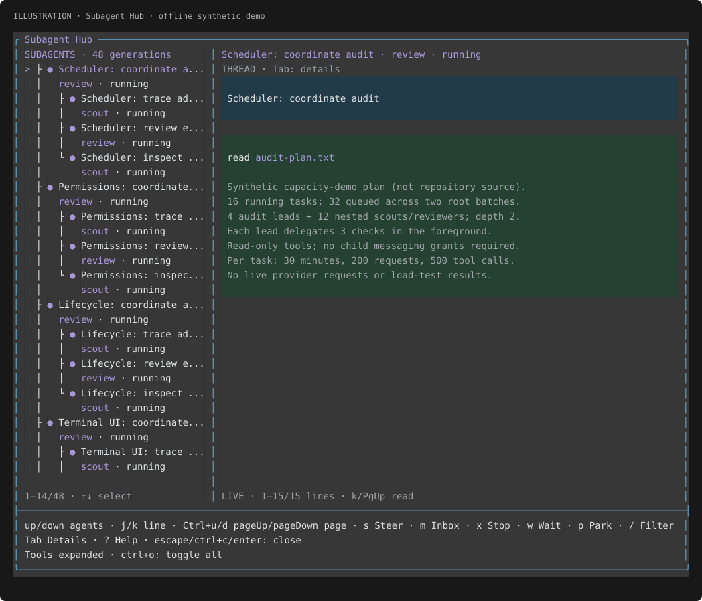
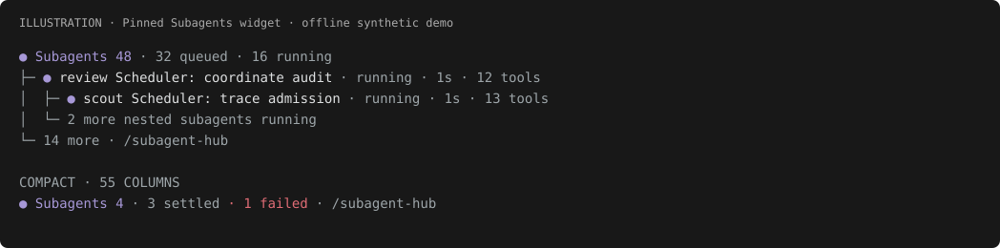

# Subagent Hub

This page covers `/subagent-hub`, its keys and steering composer, and the pinned Subagents widget.

Subagent Hub shows the task list beside the selected conversation using Pi's native renderers. On narrow terminals, the conversation takes the full width. Details shows results, artifacts, grants and usage; Tools shows full sanitized arguments and result text.

Below the steering composer, a status row shows the selected task's current model and effort with its direct usage, like Pi's main footer:

```text
↑12k ↓3.1k R40k $0.042 41.2%/200k        anthropic/claude-opus-4-5 · effort high
```

Usage counts only that generation, not its descendants. Unknown values are omitted. In narrow layouts, the model and effort stay visible and usage parts drop first. The row follows fallback and prewalk model switches as they happen.

The thread follows new output until you scroll up. Press End to follow again. The pinned Subagents widget appears after the first task starts. Compact summaries retain explicit failed counts, distinct from settled or cancelled tasks without relying on color. Summary-only fleets include a `/subagent-hub` hint within the widget's existing row budget at practical widths (for example, 55 columns). Closing Subagent Hub does not stop the work.

The Hub and widget illustrations use native renderer output with a synthetic fleet filling the default 16 concurrent slots and 32-item queue. Four read-only audit leads each have three foreground descendants, reaching the default nesting depth of two. The queue represents two further 16-task root batches, not one oversized batch. These are illustrations, not terminal screenshots or live-provider stress-test evidence. Regenerate them with `node scripts/render-hub-hero.ts` and `node scripts/render-hub-hero.ts --widget`.



_Subagent Hub at default capacity: tasks and conversations side by side, with nested scouts/reviewers at depth two. The roster scrolls through all 48 tasks._

| Key                   | Action                                                                      |
| --------------------- | --------------------------------------------------------------------------- |
| ↑ / ↓                 | Select a subagent or historical generation                                  |
| j / k                 | Scroll down / up one line                                                   |
| Ctrl+u/d or PgUp/PgDn | Scroll a page                                                               |
| Home / End            | Top / latest output                                                         |
| Tab                   | Switch between thread, details and tools                                    |
| /                     | Filter the subagent list                                                    |
| Enter                 | Focus the thread-column composer to steer the selected running task         |
| m                     | Send an inbox message                                                       |
| x, then y             | Stop the selected subtree; Enter does not confirm                           |
| w / p                 | Wait briefly for an outcome / park an idle task                             |
| ?                     | Open browse help; ? or cancel returns to the same view and reading position |
| Enter (in input)      | Send the steer or inbox message, or apply the filter                        |
| Esc / Ctrl+C          | Cancel input, return from help, or close the Hub                            |

These are the default keys. The footer names the next Tab view, the configured confirm key for steering and the configured cancel keys that close the Hub. Enter never closes the Hub. Tool expansion uses the configured `app.tools.expand` keys (default Ctrl+O), with its current expanded/collapsed state shown in the thread footer; unbound actions have no fallback key. Browse `?` opens observation-only, scrollable help that blocks underlying controls. In filter/steer/inbox inputs, printable `?`, j/k and Space remain text. Stop still requires **y**, never Enter.

The bottom row of the conversation column is a steering composer for the selected task. It shows whether the task can be steered: only running tasks accept steering. Press Enter to focus it, type the message and press Enter to send, or Esc to leave without sending. The target is pinned when the composer opens, so selecting another task or filtering does not retarget it. An empty message sends nothing. If the task stops before you send, nothing is sent and your text stays in the composer until you press Esc.

Mouse-wheel scrolling works in fullscreen mode. In regular mode, use the keyboard controls because the terminal owns mouse scrollback. Actions and pending/success/error notices identify the original task UUID, generation and task label even after selecting another task or filtering it out. Controls refuse to submit if the window cannot show the full target. A stopped-and-drained notice appears only after drain completes; inbox receipt state and queued/handled steering are not model acknowledgment. Navigation, help, resize and closing do not dispatch task controls.

## Pinned Subagents widget



_Pinned Subagents widget at default capacity: 16 running tasks and 32 queued. Below it, a separate 55-column example shows the failure count and `/subagent-hub` even when no tasks are running. Synthetic demo data, not a live load test._
