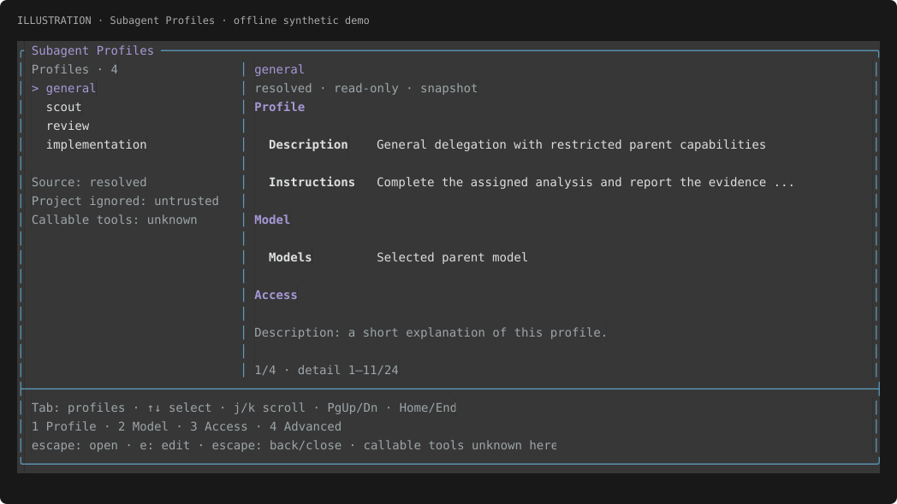

# Subagent Profiles

This page explains the `/subagent-profiles` Inspector and editor: browsing profiles, editing prompts, tools, skills and model chains, and how saves, drafts and recovery work. For the configuration file format, see [Configuration](configuration.md).

Run `/subagent-profiles` to inspect bundled, global operator and trusted-project profiles. The read-only Inspector is the landing view: a profile rail beside a spaced label/value overview, with complete setting details, provenance and configuration paths available on demand; **no write destination is selected automatically**.

1. Select a role with ↑/↓. Tab switches focus between profiles and settings; 1–4 jump to **Profile**, **Model**, **Access** and **Advanced** in the overview. Enter (or the configured confirm key) opens the selected setting read-only; Escape returns to its overview row. Narrow screens keep a compact selected-role strip above settings. Press `e` to edit, then choose **Global operator settings** or **Trusted project settings**, checking the exact path. Project editing is unavailable until the host already trusts the workspace; the editor never changes trust.
2. Open **Description** or **Instructions**, then select its edit control to use native input. Ctrl+Left stays native word navigation; it never saves or leaves text input. Commit a description with Enter or by tabbing back to the profile rail (once only). Submit multiline instructions with the native editor; Tab instead keeps a changed buffer as an **unsaved draft** and focuses profiles. Browse another profile, then select **Resume Global general.prompt draft** (for example) to return to the original buffer and caret. Reopening its field also resumes it. Escape while editing explicitly cancels only that active buffer, not other drafts or accepted saves. Opening unchanged text creates no draft. Each committed action autosaves in order, without Apply/Cancel or ordinary file review. Pending badges and **Saving / Pending** values are distinct from **Saved · verified** and unsaved drafts. The destination and exact path stay pinned across profile changes.
3. Open **Tools**, **Skills** or General’s **Reviewed tools** to inspect complete entries. On `[x]` / `[ ]` membership rows, Space or the configured confirmation key toggles once and saves immediately; arrow movement only selects. Space is not an action on model-navigation, reset/revoke or disabled rows. **Delegation** groups **Spawn targets (spawn)** and **Coordination (coordination)** separately. Overview counts are ceilings; inherited and explicit-empty declarations remain distinct in details. Exact skill/leaf additions use native text input; removing the last member stores `[]`, while **Reset … to inherited** removes the layer key. These are ceilings, not proof that tools are callable. Within settings, ↑/↓ selects controls, Enter activates, j/k and PgUp/PgDn scroll, and Home/End selects the first/last control. Text and catalog search retain printable Space, j/k and `?`. Focused hints distinguish opening, editing, immediate saves, reset/revoke, disabled controls and structural review; native text submission uses its own binding, not the selection-confirm binding. Narrow screens stack the profile selector; tiny/short screens request resize without activating hidden controls.
4. Open **Models** to edit the chain: one row per target, in the order they run. The first row is the default, shown as `provider/id` with its effort on the right (for example `google-antigravity/claude-sonnet-5-5   ◔ low`). Fallbacks follow as `↳ provider/id:effort`. A saved target that this session can't run keeps its row with `⚠ unavailable` or `⚠ restricted`, and stays movable and removable. The help line shows the selected target's friendly name, exact `provider/id · effort` and any full warning. Select a row with ↑/↓, then use the keys listed in the bottom hint:
   - **←/→** previews another supported, eligible effort. The row shows `[◑ medium] · unsaved`, plus `· adds grant` when that exact effort has no grant yet. Efforts that another row of the chain already uses are skipped, and at 64 grants only granted efforts are offered. **Enter** saves the change, adding at most one grant and keeping the old one. Escape, moving the selection, switching profile or opening the picker discards the preview without saving.
   - **Enter**, with nothing previewed, opens the model picker (next step) to replace that target in place, titled for example **Replacing fallback 1 in general**. Any accessible model and effort that isn't already in the chain can take its position.
   - **Shift+↑/↓**, or `[` and `]`, moves the target earlier or later. The selection follows it, so moving a fallback above the first row makes it the default.
   - **x** or **Delete** removes the target and keeps its grants; the selection moves to the next row. On the last target, the row warns before you press the key: removing it saves `fallback:false`, and the resulting unchained model/parent route may still be denied by current permissions.
   - **f**, or **+ Add fallback…**, opens the picker to add a target. Global additions atomically save routing and any needed exact grant, without a modal. **Global affects other workspaces, and grants also permit explicit overrides—not only fallback.** With prewalk configured, the row reads **+ Switch from prewalk and add…** and saves that labeled compound switch, never hidden cleanup.

   Below a divider, **Disable chain** and **Reset chain to inherited** are separate actions. Without a chain, a muted `— unchained → …` row names the model or parent route that runs instead. Project can only keep or remove an authorized ordered subsequence: the other keys show their reason and save nothing, so change destination explicitly to Global for them. At 64 targets, adding is disabled. Escape with nothing previewed returns to the overview.

5. The model picker opens with its title (for example **Adding to general chain — ⏎ assigns, ⎋ cancels**) and the destination, grant and save disclosures on the muted line below it. Typing always goes to the `🔍 >` search, including Space, j/k and `?`; it matches names, provider labels, provider IDs and model IDs, and ←/→ move the text cursor. Alt+←/→ (⌥←/→) or Tab/Shift+Tab switch the **Provider** tabs. Each row shows the muted `provider/` and the model ID, followed by reasoning (🧠), context window (`1m`, `500k`, `8.2k`) and price per million input/output tokens (`$2/10`; `$0` when the host reports zero, which may mean unknown). Narrow layouts drop price, then context, then reasoning. When adding to or replacing in a chain, models that already have an exact grant on this profile are listed first, above a divider. ↑/↓ move through the list, and the line under it describes the highlighted model (name, context, output limit, price, reasoning, vision). Press Enter to open the effort strip (for example `Effort: ⦸ off  [◔ low]  ◕ high`). When replacing, it starts on the replaced target's effort if the chosen model supports it eligibly; otherwise on an effort that already has an exact grant, otherwise the first eligible effort. ←/→ move across every supported effort; ineligible efforts are dimmed and show their exact reason, and Enter on them does nothing. Enter on an eligible effort rechecks a fresh host snapshot and then saves; if the model became unavailable, the reason is shown and the picker stays open. Typing or ↑/↓ leave the strip, Escape returns from the strip to the list, and Escape in the list cancels without saving. Models with no eligible effort are hidden; when space allows, a note summarizes why, and short layouts show only a hidden count. **F1** opens scrollable exact-ID, supported-effort and hidden-reason details; F1/Escape returns without accepting a selection. **Ctrl+R** rereads the host snapshot only, never network/provider caches. Unavailable saved selections stay warning rows and do not block unrelated edits/removal/reorder. New selections are rechecked on confirmation and when their queued action executes. Unchained model/prewalk and standalone grants use the same picker and also autosave; a grant needed by routing cannot be removed until routing is adjusted.
6. Open **Advanced** for prewalk policy, exact model grants, raw/inherited/effective diagnostics, custom create/copy/delete, whole-override reset, local ceilings and operator authorization/registration. While a chain is active, its default is edited only through the first entry in **Models**, not a separate Advanced default control. Without a chain, Advanced retains the unchained model control. Existing `model` settings and runtime bypass/disable behavior are unchanged; editing the chain does not rewrite the unchained setting, which remains inspectable in source diagnostics. Structural operations first finish ordinary saves, then retain explicit transaction review/save and confirmations. Blank definitions start with empty grants. A copy is independent, not live inheritance; copying `general` excludes automatic skill inheritance/leaf forwarding and requires explicit review of copied skill paths. For a Project-local role, first authorize named global ceilings, then choose one during trusted-Project creation. This authority is not a spawn grant. Returning from a structural transaction rereads current configuration before ordinary editing resumes. Merely opening/closing Advanced or other settings never saves or grants anything. Escape first cancels unfinished native input or a previewed effort, then returns from the setting to the overview; outer close finishes accepted saves.

The profile/model flow is sized for a physical **80×24** terminal (72×21 production overlay; the nested catalog has 68×14). Focus entering settings follows the selected label, not its full value or trailing spacer. In **Advanced → Exact model grants**, select a numbered **Remove grant** row and use j/k or paging to read its full exact provider/ID/effort and warning. Confirming revokes only that grant, and remains disabled while routing requires it. A clipped value or warning does not disable a visible label; a genuinely hidden label still cannot activate. Below baseline, resize messages retain local back/cancel without saving or dispatching hidden controls; grow the terminal to continue from the same selection.

Reset removes only the selected-layer override. Delete removes a custom definition and blocks on local configuration references and nonterminal/reusable tasks; references must be removed explicitly and tasks stopped/drained using existing controls. It does not scan other workspaces or mutate history. See the [configuration and persistence contract](delegation-contract.md#custom-definitions-and-project-role-ceilings).

On a known pre-replacement failure, **Not saved** retains the attempted action and freezes later mutations. Any unrelated unfinished text—including an exact-entry input—is retained separately as a named draft. Browse profiles and Resume text while paused, but submission/blur cannot enqueue it. **Retry** retries the same accepted action; **Revert** discards the disclosed number of unsaved actions. Both retain unsubmitted drafts and previously verified saves; neither submits drafts automatically. After recovery, explicitly Resume and submit a draft when ready.

A relevant external edit, any trust change, or completed/unknown replacement requires **Reload**, which abandons the whole unsaved tail without merge, replay, force-write or rollback. If drafts exist, Reload identifies their destination/profile/field and discloses both draft and queued-change counts before an explicit discard-and-continue decision. The default **Keep drafts and return** (or Escape) abandons neither. Only currently trusted Project layers are read. Malformed Reload leaves an explanatory read-only state that can be closed; confirmed discards remain discarded even if reopening fails.

Close, destination changes, structural Advanced actions and resetting/replacing a drafted field likewise ask you to keep drafts or explicitly discard affected text. Ordinary profile browsing and unrelated toggles do not. Once draft disposition is resolved, close/destination/structural navigation shows **Finishing saves** and navigates only after every accepted action verifies. Any failure cancels that navigation; Retry cannot unexpectedly close the Inspector. Drafts are in memory for this Inspector only, not saved on disk. Force-quitting the process can lose queued/unfinished input; there is no durable recovery journal. At the physical 80×24 baseline (72×21 overlay), draft/exit controls remain available. Smaller terminals may request resize; resize itself never discards, and Escape's local hint distinguishes cancelling active text from keeping suspended drafts. The existing external-writer race between final check and rename is not eliminated by the in-memory FIFO.

Saved instructions apply to new sessions, not retained prompt/history replacement. Grant revocations can deny later runtime operations; admitted tasks never gain new authority from an edit. No agent restarts automatically. Reopen the viewer to refresh an externally changed snapshot.

To enable **nested project-local targets**, explicitly register an exact name and required ceiling in **Register project-local spawn targets** under Advanced in Global. Review/save this structural authorization, then separately toggle the name in the parent's **Delegation → Spawn targets (spawn)** membership list; that item autosaves. A trusted project must define that exact name with the exact registered ceiling. Registered-but-absent names are conditional choices, not profiles or discovery placeholders, and cannot launch until the local definition exists.

**Registration scope is every trusted project using these operator settings**, not only the current workspace. Each trusted project may supply independent instructions for the registered name under its ceiling. Registration is neither a parent spawn grant nor authorization for every role under a ceiling. Root local launches do not require incoming registration. See the [exact paired configuration](delegation-contract.md#custom-definitions-and-project-role-ceilings).

**Ceilings are not callable tools.** Pi's command context has no callable-tool dispatcher, so the viewer/editor report callable tools as unknown rather than treating active declarations as executable grants. Admission performs the real intersection and remaining checks; inspect a task's `tools` in Hub Details or the `subagent` status action. RPC, JSON and print modes retain the structured `{toolPolicy, profiles}` message instead of opening an overlay. Invalid configuration or missing/invalid granted skills fails resolution, as at admission.

_Synthetic native-component output; not a terminal screenshot or live-provider verification. Regenerate with `node scripts/render-hub-hero.ts --profiles`._
